<div align="center">

# Workora

**A secure, full-stack job application tracker, built with Java 21 and Spring Boot 4, tested with JUnit 5 and Testcontainers, containerized with Docker and deployed through a CI/CD pipeline.**

[](https://github.com/YOUR-USERNAME/workora/actions/workflows/ci.yml)


### [Live demo: workora-bbjl.onrender.com](https://workora-bbjl.onrender.com/)

<sub>The demo runs on free hosting tiers. After a quiet period the first load can take about a minute while the server wakes up.</sub>

</div>

<!-- 📸 SCREENSHOT 1: docs/screenshots/dashboard-desktop.png
     Dashboard on desktop with 8+ applications in different statuses, so the pipeline bar shows several colours. -->
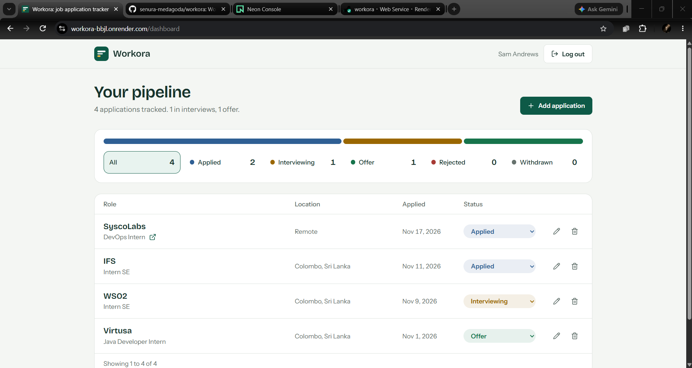

---

## What this project demonstrates

| Skill | Evidence in this repository |
|---|---|
| **Java and Spring Boot** | Layered REST API (controller, service, repository), Spring Security resource server, Spring Data JPA, Bean Validation, global error handling, Actuator |
| **Application security** | JWT access tokens, rotating refresh tokens with reuse detection, owner-scoped data access, hardened cookies, Content-Security-Policy |
| **Automated testing** | JUnit 5, Mockito, AssertJ, MockMvc and Testcontainers running the integration tests against a **real PostgreSQL** |
| **Database engineering** | Versioned Flyway migrations, constraints, indexes, Hibernate in `validate` mode |
| **Containerization** | Multi-stage Dockerfile, non-root runtime, JVM tuned for a 512 MB container |
| **CI/CD and deployment** | GitHub Actions (tests, lint, build, image build), automatic deploys to Render, managed PostgreSQL on Neon |
| **Frontend** | React, TypeScript, Tailwind CSS, TanStack Query, accessible and responsive UI |

---

## Features

- Create an account and log in. The app is private: visitors who are not logged in see only the landing page, login and registration.
- Add job applications with company, role, location, job link, date and notes.
- Change an application's status (Applied, Interviewing, Offer, Rejected, Withdrawn) directly from the list.
- Edit and delete applications, with a confirmation step before deleting.
- A **pipeline bar** that shows the distribution of statuses at a glance and doubles as a filter.
- Pagination, plus designed loading, empty and error states.
- Responsive from small phones to wide desktops, keyboard accessible, and respectful of reduced-motion settings.

<!-- 📸 SCREENSHOTS 2 and 3: docs/screenshots/landing.png and docs/screenshots/dashboard-mobile.png
     Landing page (desktop) and the dashboard at 375px wide (phone). -->
<table>
  <tr>
    <td width="68%">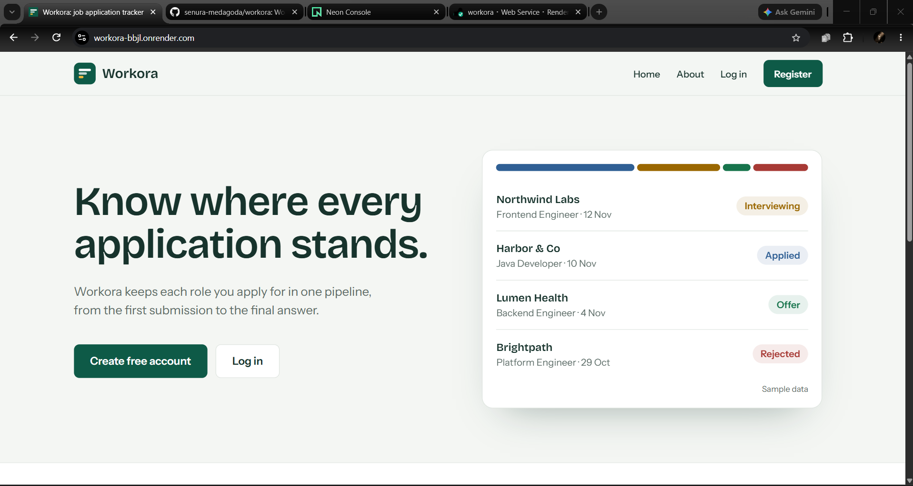</td>
    <td width="32%">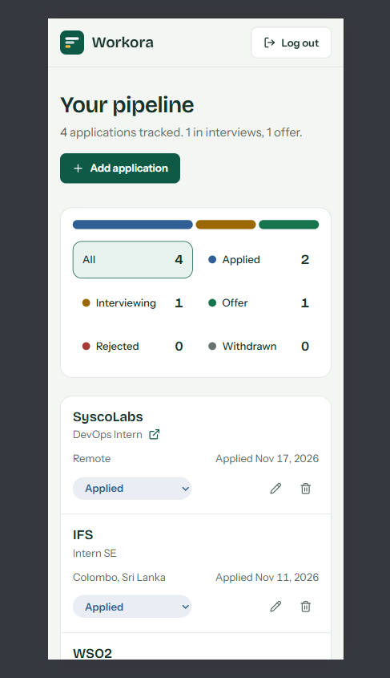</td>
  </tr>
</table>

<!-- 📸 SCREENSHOT 4: docs/screenshots/add-application.png
     The "Add application" dialog open in the middle of the screen over the dimmed dashboard. -->
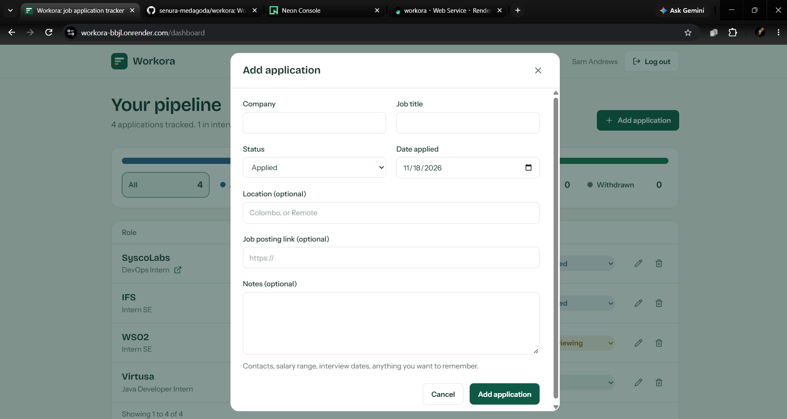

---

## Tech stack

| Layer | Technology |
|---|---|
| **Backend** | Java 21, **Spring Boot 4.1**, Spring Security 7 (OAuth2 resource server), Spring Data JPA / Hibernate, Bean Validation, Spring Boot Actuator, Lombok |
| **Database** | PostgreSQL, **Flyway** migrations |
| **Testing** | **JUnit 5**, **Mockito**, AssertJ, Spring MockMvc, **Testcontainers** |
| **Frontend** | React, TypeScript, Vite, Tailwind CSS, TanStack Query, React Hook Form, Zod |
| **Containers** | Docker (multi-stage build), Docker Compose for local development |
| **CI/CD** | GitHub Actions |
| **Hosting** | Render (Docker web service), Neon (managed PostgreSQL) |
| **API docs** | OpenAPI / Swagger UI (development only) |

---

## Architecture

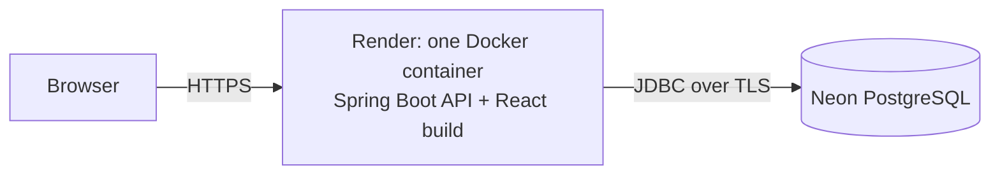

The React app is built inside the Docker image and served by Spring Boot, so the website and the API share **one origin**. This keeps the refresh cookie `SameSite=Strict` and removes the need for CORS configuration.

### Backend structure (package by feature)

```
backend/src/main/java/com/workora/
├── auth/            register, login, refresh, logout, refresh-token rotation
├── user/            user entity, repository, profile endpoint
├── jobapplication/  entity, repository, service, controller, DTOs
├── security/        JWT configuration and the security filter chain
├── common/          global exception handler, shared response types
└── config/          OpenAPI setup, SPA routing
```

Each request flows through three layers, and each layer only talks to the one below it:

```
Controller  →  Service  →  Repository  →  PostgreSQL
(HTTP, validation)  (business rules, transactions)  (queries)
```

---

## Spring Boot backend highlights

- **DTOs everywhere.** Entities are never exposed. Requests and responses are separate records, so a client can never set fields like `userId`.
- **Bean Validation** on every input, with length limits on all strings. Job links must start with `http://` or `https://`, which blocks `javascript:` URLs.
- **Global error handling** built on `ResponseEntityExceptionHandler`. Every error is an RFC 9457 problem response, validation errors list the failing fields, and a safe catch-all hides internals.
- **Flyway migrations** own the schema (`V1` users, `V2` refresh tokens, `V3` job applications). Hibernate runs in `validate` mode and never changes the database.
- **Database design:** UUID primary keys, a unique index on `lower(email)`, foreign keys with cascade, a `CHECK` constraint on status, and indexes that match the query patterns.
- **Transactions** are explicit: `@Transactional(readOnly = true)` for reads, `saveAndFlush` where the response needs generated values, and `noRollbackFor` where a security action must survive an exception.
- **Pagination** with a hard size cap, and fixed server-side sorting.
- **Externalized, validated configuration.** `@ConfigurationProperties` with validation: the app refuses to start if the JWT secret is missing or shorter than 32 characters.
- **Profiles:** `dev` (default, Docker Compose support and Swagger on) and `prod` (selected inside the Docker image).

---

## Security design

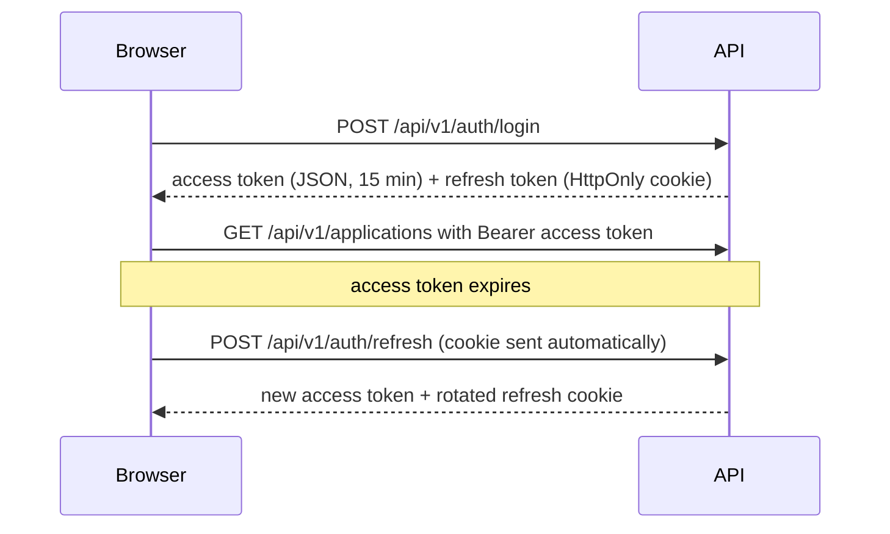

- **Short-lived access tokens.** A JWT valid for 15 minutes, signed with HS256 and a pinned algorithm. The browser keeps it in memory only, never in `localStorage`.
- **Rotating refresh tokens.** A random 256-bit token in an `HttpOnly`, `Secure`, `SameSite=Strict` cookie scoped to `/api/v1/auth`. Each token works only once. If an old one is replayed, the server treats it as theft and revokes every token of that user.
- **Hashed refresh tokens.** Only the SHA-256 hash is stored, so a database leak does not expose usable tokens.
- **Passwords.** BCrypt through Spring Security's delegating encoder, with a 12-character minimum (following current NIST guidance). Login answers are identical for unknown emails and wrong passwords, and a hash comparison always runs, to avoid user enumeration through response timing.
- **Owner-scoped data (IDOR protection).** The user id comes from the verified token, never from the request. Every query includes the owner, and another user's record returns `404`, so its existence is never confirmed.
- **Deny by default.** Everything under `/api` requires authentication, and unknown methods or paths are refused.
- **Browser hardening.** Content-Security-Policy, `X-Content-Type-Options`, `X-Frame-Options`, HSTS, and `rel="noopener noreferrer"` on outbound links.
- **No secret defaults.** The production JWT secret has no default value, and secrets are injected as environment variables and excluded from the Docker image.
- **Client-side isolation.** The query cache is cleared on logout so the next user never sees the previous user's data.

<!-- 📸 SCREENSHOT 5: docs/screenshots/security-cookie.png
     Browser DevTools, Application tab, Cookies: the workora_refresh cookie showing HttpOnly, Secure and SameSite=Strict (taken on the LIVE site). -->
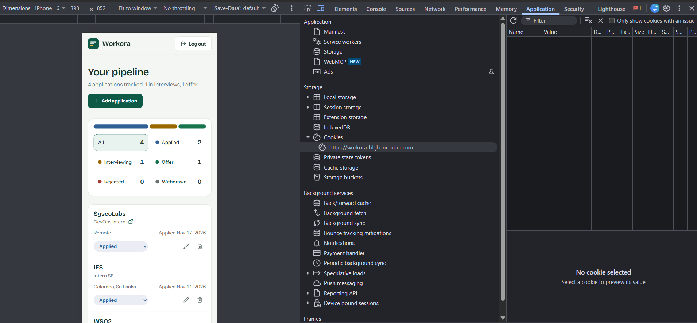

<!-- 📸 SCREENSHOT 6: docs/screenshots/security-headers.png
     Terminal output of:  curl.exe -I https://workora-bbjl.onrender.com/
     showing content-security-policy, strict-transport-security, x-frame-options and x-content-type-options. -->
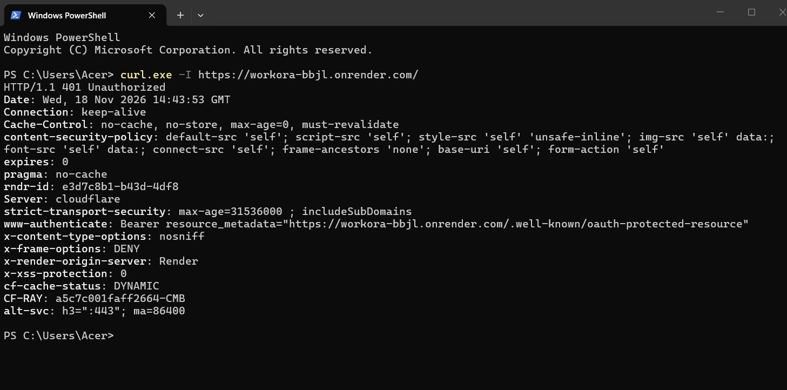

---

## Testing

Testing is a core part of this project. The strategy follows the test pyramid: many fast **unit tests** at the bottom, fewer **integration tests** above them.

| Level | Tools | What it covers |
|---|---|---|
| **Unit tests** | JUnit 5, Mockito (`@Mock`, `@InjectMocks`, `ArgumentCaptor`), AssertJ | Services and JWT logic in isolation, with no Spring context and no database |
| **Integration tests** | `@SpringBootTest`, MockMvc, **Testcontainers (real PostgreSQL)** | Full HTTP flow through the real security filter chain, real Flyway migrations and real SQL |

Integration tests run against the **same database engine as production**, not an in-memory substitute, so migration and query bugs are caught before deployment.

### What the tests prove

| Behaviour | Level |
|---|---|
| A generated JWT carries the right subject, role and issuer | Unit |
| Tokens signed with the wrong key, expired tokens, and tokens from the wrong issuer are **rejected** | Unit |
| Registration normalizes the email and stores only a BCrypt hash, never the password | Unit and integration |
| Duplicate emails (in any letter case) return `409` | Integration |
| Wrong password and unknown email produce **identical** responses, and a hash comparison always runs (anti-enumeration) | Unit and integration |
| Login sets the refresh cookie with `HttpOnly`, `SameSite=Strict` and a scoped path, and keeps the refresh token out of the JSON body | Integration |
| Refresh **rotates** the token, and **replaying an old token revokes the whole token family** | Integration |
| Logout revokes the refresh token and clears the cookie | Integration |
| Every protected endpoint returns `401` without a valid token | Integration |
| **User B cannot read, edit, change the status of or delete user A's application** (all return `404`, and A's data is unchanged) | Integration |
| Validation rejects blank fields, unknown statuses and unsafe job links (`javascript:`, `ftp:`, `data:`) using parameterized tests | Integration |
| Pagination, status filtering and a page-size cap (`0`, `-1` and `51` all return `400`) | Integration |
| Stats count only the caller's applications and report `0` for empty statuses | Unit and integration |

A short excerpt, the access-control test:

```java
@Test
@DisplayName("another user cannot read, edit, change the status of or delete my application (all 404)")
void otherUsersApplication_isInvisibleAndUntouchable() throws Exception {
    String aliceId = create(alice, json("Alice Secret Co", "Dev", "APPLIED"));
    String url = BASE + "/" + aliceId;

    mockMvc.perform(get(url).header(AUTHORIZATION, bearer(bob)))
            .andExpect(status().isNotFound());
    mockMvc.perform(delete(url).header(AUTHORIZATION, bearer(bob)))
            .andExpect(status().isNotFound());

    // Alice's record is completely unchanged
    mockMvc.perform(get(url).header(AUTHORIZATION, bearer(alice)))
            .andExpect(status().isOk())
            .andExpect(jsonPath("$.companyName").value("Alice Secret Co"));
}
```

### Run the tests

```bash
cd backend
./mvnw verify          # Windows: .\mvnw.cmd verify   (Docker must be running)
```

All **XX tests** pass. They also run automatically on every pull request in CI.

<!-- 📸 SCREENSHOT 7: docs/screenshots/tests-passing.png
     IntelliJ's Run window with all test classes expanded and green, OR the terminal ending with
     "Tests run: XX, Failures: 0, Errors: 0" and BUILD SUCCESS. -->
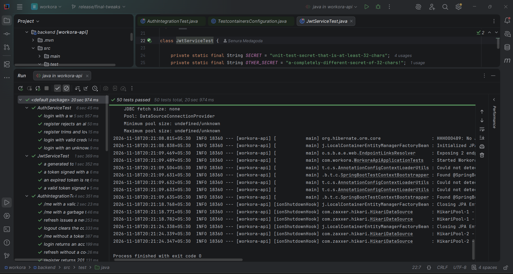

---

## Containerization

The whole application ships as **one Docker image**, built with a three-stage Dockerfile:

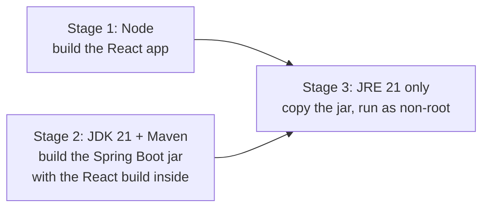

<details>
<summary><b>View the Dockerfile</b></summary>

```dockerfile
# Stage 1: build the React app
FROM node:22-alpine AS frontend
WORKDIR /app
COPY frontend/package.json frontend/package-lock.json ./
RUN npm ci
COPY frontend/ ./
RUN npm run build

# Stage 2: build the Spring Boot jar, with the React build inside it
FROM eclipse-temurin:21-jdk-alpine AS backend
WORKDIR /app
COPY backend/.mvn .mvn
COPY backend/mvnw backend/pom.xml ./
RUN sed -i 's/\r$//' mvnw && chmod +x mvnw
COPY backend/src src
COPY --from=frontend /app/dist src/main/resources/static
RUN ./mvnw -B -q -DskipTests package

# Stage 3: small runtime image
FROM eclipse-temurin:21-jre-alpine
RUN addgroup -S app && adduser -S app -G app
WORKDIR /app
COPY --from=backend /app/target/*.jar app.jar
USER app
ENV JAVA_TOOL_OPTIONS="-XX:MaxRAMPercentage=60 -XX:+UseSerialGC -XX:TieredStopAtLevel=1 -Xss512k"
ENV SPRING_PROFILES_ACTIVE=prod
EXPOSE 8080
ENTRYPOINT ["java", "-jar", "app.jar"]
```

</details>

**Design choices**

- **Multi-stage build.** Node, Maven and the full JDK exist only in the build stages. The final image contains just a JRE and the jar: no build tools, no source code.
- **Non-root user.** The application runs as an unprivileged user inside the container.
- **Secrets stay out of the image.** `.dockerignore` excludes `.env`, and all configuration is passed as environment variables at runtime.
- **Tuned for small hosts.** JVM flags (serial GC, C1-only JIT, capped heap percentage) let the app run inside a 512 MB container.
- **Build once, run anywhere.** The same image runs on a laptop and in production. CI builds it on every pull request, so a broken image can never reach `main`.

### Run the production image locally

```bash
docker build -t workora .
docker run --rm -p 8080:8080 \
  -e SPRING_DATASOURCE_URL=jdbc:postgresql://HOST:5432/DB \
  -e SPRING_DATASOURCE_USERNAME=USER \
  -e SPRING_DATASOURCE_PASSWORD=PASSWORD \
  -e WORKORA_JWT_SECRET=a-long-random-secret-of-at-least-32-characters \
  workora
```

<!-- 📸 SCREENSHOT 8: docs/screenshots/docker-image.png
     Terminal showing a successful `docker build -t workora:local .` and the output of `docker images workora:local`
     (so the small image size is visible). -->
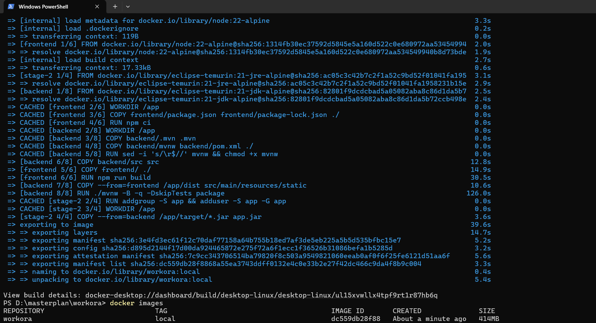

---

## CI/CD and deployment

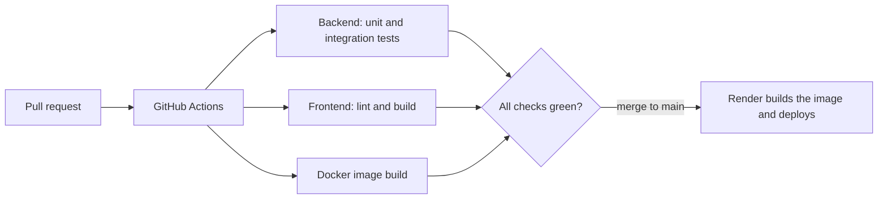

- **GitHub Actions** runs three jobs on every pull request and on pushes to `main`: backend tests (with Docker available for Testcontainers), frontend lint and build, and the production image build.
- **Continuous deployment.** Merging to `main` makes **Render** build the Docker image from the repository and roll it out. Changes go through branch, pull request, green checks, merge.
- **Managed database.** **Neon** hosts PostgreSQL over TLS. Flyway applies migrations on startup, using a direct (non-pooled) connection.
- **HTTPS** is terminated by the platform, and the app trusts the forwarded protocol headers so secure cookies and HSTS behave correctly.
- **Health checks.** The platform uses Spring Boot's **liveness probe**, which does not touch the database, so the free database can sleep while the app is idle.

### Production configuration

| Variable | Purpose |
|---|---|
| `SPRING_DATASOURCE_URL` | JDBC URL of the PostgreSQL database |
| `SPRING_DATASOURCE_USERNAME` | Database user |
| `SPRING_DATASOURCE_PASSWORD` | Database password |
| `WORKORA_JWT_SECRET` | Signing key for access tokens (at least 32 characters). There is deliberately **no default**, so the app refuses to start without it |
| `PORT` | Provided by the hosting platform |

<!-- 📸 SCREENSHOT 9: docs/screenshots/ci-pipeline.png
     The GitHub Actions page of a successful run, showing the three green jobs (backend, frontend, docker). -->
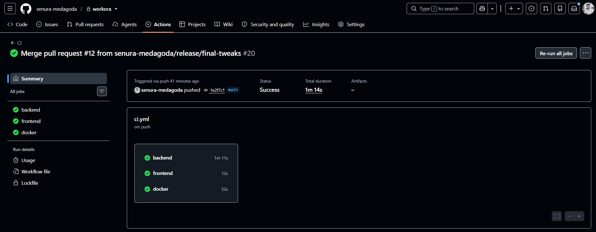

<!-- 📸 SCREENSHOT 10: docs/screenshots/render-live.png
     Render dashboard: the workora service with the green "Live" status and the log line "Started WorkoraApiApplication".
     HIDE or do not open the Environment tab. -->
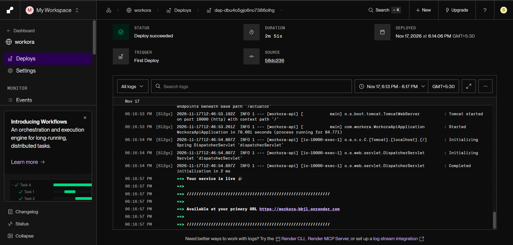

<!-- 📸 SCREENSHOT 11: docs/screenshots/neon-database.png
     Neon SQL Editor showing the result of:  select email, left(password_hash, 12) as hash_prefix from users;
     with the {bcrypt} prefix visible. Blur the email addresses. -->
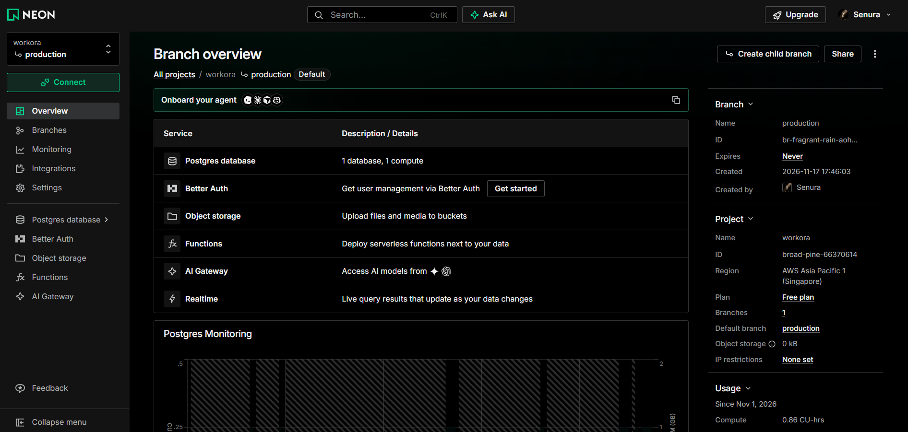

---

## REST API

Interactive documentation (Swagger UI) is available in development at `http://localhost:8080/swagger-ui.html` and is disabled in production.

| Method | Path | Description |
|---|---|---|
| POST | `/api/v1/auth/register` | Create an account |
| POST | `/api/v1/auth/login` | Log in. Returns an access token and sets the refresh cookie |
| POST | `/api/v1/auth/refresh` | Rotate the refresh token and return a new access token |
| POST | `/api/v1/auth/logout` | Revoke the refresh token and clear the cookie |
| GET | `/api/v1/users/me` | The current user's profile |
| GET | `/api/v1/applications` | List your applications (`status`, `page`, `size`) |
| GET | `/api/v1/applications/stats` | Counts per status |
| POST | `/api/v1/applications` | Create an application |
| GET | `/api/v1/applications/{id}` | Get one application |
| PUT | `/api/v1/applications/{id}` | Replace an application's details |
| PATCH | `/api/v1/applications/{id}/status` | Change only the status |
| DELETE | `/api/v1/applications/{id}` | Delete an application |

<!-- 📸 SCREENSHOT 12: docs/screenshots/swagger-ui.png
     Swagger UI (local, http://localhost:8080/swagger-ui.html) with the "Job applications" endpoints visible
     and the green Authorize button at the top. -->


---

## Run it locally

**Prerequisites:** JDK 21, Node.js 22 (LTS), Docker Desktop.

**1. Database and backend**

```bash
cd backend
cp .env.example .env          # then edit .env and set a real password
docker compose up -d          # starts PostgreSQL on localhost:5433
./mvnw spring-boot:run        # Windows: .\mvnw.cmd spring-boot:run
```

The backend starts on http://localhost:8080 using the `dev` profile, which includes a development-only JWT secret.

**2. Frontend**

```bash
cd frontend
npm install
npm run dev
```

Open http://localhost:5173. The dev server proxies `/api` to the backend, so the browser sees a single origin, exactly like production.

**3. Tests and checks**

```bash
cd backend && ./mvnw verify          # unit and integration tests
cd ../frontend && npm run lint && npm run build
```

---

## Engineering challenges and how I solved them

| Challenge | Solution |
|---|---|
| **Refresh-token rotation breaks under concurrent requests.** React StrictMode, or several calls failing at once, could send the same single-use refresh token twice, which looks like token theft and logs the user out | The frontend keeps a **single in-flight refresh promise** that every caller shares, so the token is never sent twice |
| **Reuse detection must survive its own exception.** Revoking all tokens and then throwing would normally roll the revocation back | `@Transactional(noRollbackFor = ...)` keeps the revocation committed |
| **Cookie security vs. deployment.** A `SameSite=Strict` cookie needs the site and the API on one origin | Built the React app into the Spring Boot image so both are served from one origin, with no CORS |
| **Refreshing a client-side route returned 404** | A small forwarding controller returns `index.html` for SPA routes, while `/api` and unknown paths stay protected |
| **Flyway on a pooled serverless database.** Connection poolers in transaction mode do not support everything migration tools need | Use Neon's **direct** connection, with a small application-side pool |
| **Free database kept awake by health checks.** The default health endpoint queries the database | Enabled Spring Boot's **liveness probe** (no database call) for the platform's health checks |
| **Docker build failed on Windows line endings in `mvnw`** | Strip carriage returns in the Dockerfile before running the wrapper |
| **Leaking data between users in the browser cache** | Clear the query cache on logout and on forced sign-out |

---

## Design decisions and trade-offs

- **One image, one origin.** Simpler cookies, headers and deployment, at the cost of coupling the frontend release to the backend release.
- **Flyway instead of `ddl-auto`.** Every schema change is versioned and reviewable.
- **`404` instead of `403` for other users' records.** Avoids confirming that a record exists.
- **Hard delete.** Simple and appropriate here. A system with audit requirements would use soft deletes.
- **Pagination with a size cap everywhere.** Prevents unbounded responses.
- **Known limitations:** no rate limiting on login yet, no email verification, no password reset.

---

## Roadmap

- Rate limiting on authentication endpoints
- Email verification and password reset
- Search across company and job title
- Follow-up reminders and interview dates
- Code coverage reporting in CI
- Frontend component tests and end-to-end tests

---

## Author

**YOUR NAME**  
[LinkedIn](https://www.linkedin.com/in/YOUR-PROFILE) · [GitHub](https://github.com/YOUR-USERNAME) · your.email@example.com

If you are reviewing this project, the most interesting places to start are `backend/src/main/java/com/workora/auth` (token rotation), `backend/src/test` (the test suite) and the `Dockerfile`.